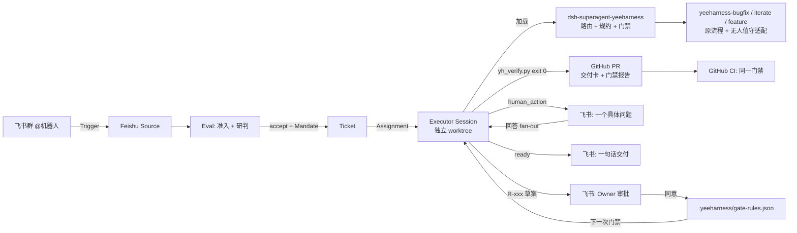

# 架构

## 分层

| 层 | 组件 | 归属 |
|---|---|---|
| 编排 | 来源、准入、工单、派工、回到原对话交付、面板 | dsh-superagent（上游，未改动业务逻辑；只为 macOS `ps` 输出解码打了一行补丁） |
| 方法 | 场景流程、审查闭环、排查方法论 | yeeHarness 原仓库（未改动），由 `build_skills.py` 打包 |
| 适配 | 无人值守映射、路由、团队提示词 | 本仓库 `team/` |
| 执行 | 交付门禁、业务规则 | 本仓库 `gate/` 与业务仓库 `.yeeharness/` |
| 度量 | 门禁基准、实跑指标、结果页 | 本仓库 `bench/`、`scripts/collect_metrics.py`、`site/` |

## 关键设计决策

- **为什么只从飞书接单？** 需求最先出现在 IM 里。GitHub 侧准入名单为空，所以 GitHub 只承担交付（PR）和评审反馈（订阅推送，不需要重新评估）。
- **为什么门禁用正则 + 测试，而不是让模型判断？** ready 的依据必须是确定性的、可复现的。模型可以修代码，但不能决定自己是否合格。
- **为什么业务规则放在业务仓库？** 这沿用 yeeHarness 的分层原则：「换一个业务团队还成立吗？」业务规则随仓库流转，只对本团队生效；公共层 P/G 仍走 Owner 审批。
- **为什么不改 yeeHarness 原技能？** 规约只保留一份，避免两份副本不一致。适配逻辑放在打包环节，IDE 用户不受影响。

## 已知限制

- dsh-superagent 是研究原型（`dsh 0.2.1-rc.3`），不建议直接用于生产。
- 只支持 github.com。接入内部 GitLab 需要新增一个 Source（预计 3–5 天，参考上游 `docs/008-cookbook.md`）。
- 演示仓库由 agent 账号持有，没有设置 CODEOWNERS。真实仓库应把 `.yeeharness/` 和 `.github/` 交给人工 Owner 审批。
- 门禁基于文本规则，不做类型推断（`equals` 检测通过文件内的 BigDecimal 声明来近似判断类型），存在漏报的可能，因此仍需人工评审。
- 代码会发送给外部模型。演示只使用脱敏代码；接入真实业务仓库前必须改用内部模型。
