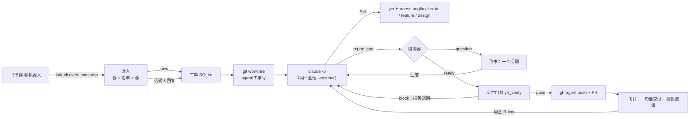

# 架构

## 分层

| 层 | 组件 | 说明 |
|---|---|---|
| 接入 | `autopilot/feishu.py`、`admission.py` | lark-cli 以机器人身份接收事件、在话题里回复；准入规则借鉴 dsh-superagent：只响应名单内、@了机器人的人；话题内的追加消息不需要再 @ |
| 编排 | `engine.py`、`store.py` | 工单状态机，SQLite 持久化，每个工单有独立 worktree 和一个 Claude 会话；事件日志供度量使用 |
| 执行 | `claude.py` + 本机 Claude Code | `claude -p` 无头运行，加载用户级的 yeeHarness 技能；系统提示词 `prompts/system.md` 把交互映射为报告文件 |
| 约束 | `gate/yh_verify.py`、`gate.py` | 门禁是 ready 的唯一依据；业务规则取基线与改动的并集，只能加强不能削弱 |
| 交付 | `workspace.py` | 只有编排器能 push 和开 PR（用 agent 账号）；Claude 被禁止使用 git push、gh、lark-cli、curl |
| 度量 | `scripts/collect_metrics.py`、`render_report.py` | 从事件日志统计注意力和成本指标，生成结果页 |

## 关键设计决策

- **为什么不用 dsh？** 团队已经有 Claude Code / Codex，yeeHarness 技能原生运行，不需要再引入新的运行时和模型供应商。dsh-superagent 的设计思想（注意力原则、准入、工单/话题订阅、结构化提问、诚实交付）都已沿用，但只实现团队需要的最小部分，约 1100 行。
- **为什么让模型写报告文件，而不是直接发消息？** 发什么、什么时候发由编排器决定：门禁没通过不会交付，同一个问题不会问两次，消息长度有上限。模型只负责工程工作。
- **为什么门禁不通过时先退回给 Claude，而不是告诉人？** 能自己修的问题不应该占用人的注意力。退回次数有上限（默认 2 次），超过后诚实地报告 blocked，并附上草稿 PR。
- **为什么业务规则放在业务仓库？** 这沿用 yeeHarness 的分层原则「换一个业务团队还成立吗」；公共层 P/G 规则仍然走 Owner 审批。

## 已知限制

- 目前只支持 GitHub。接入内部 GitLab 需要把 `workspace.publish` 换成 glab（改动集中在一个函数里）。
- 换用 Codex 需要新增一个和 `ClaudeRunner` 接口相同的 runner（`codex exec`），目前还没有实现。
- 门禁基于文本规则加简单的类型判断，存在漏报的可能，因此仍需人工评审。
- 代码会发送给 Claude 所用的模型服务。演示只使用脱敏代码；接入真实业务仓库前，要确认符合 P-007（敏感数据不出域）。
- 演示仓库没有设置 CODEOWNERS。真实仓库应把 `.yeeharness/` 和 `.github/` 交给人工 Owner 审批。
